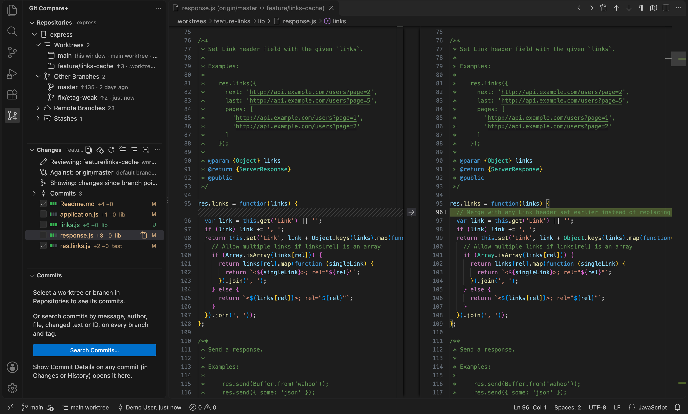
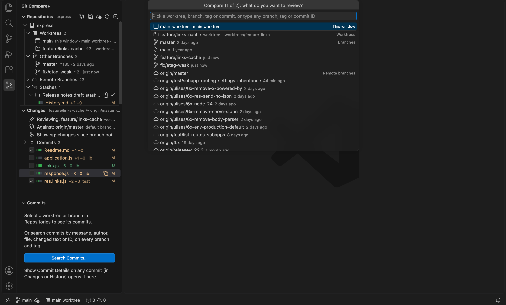
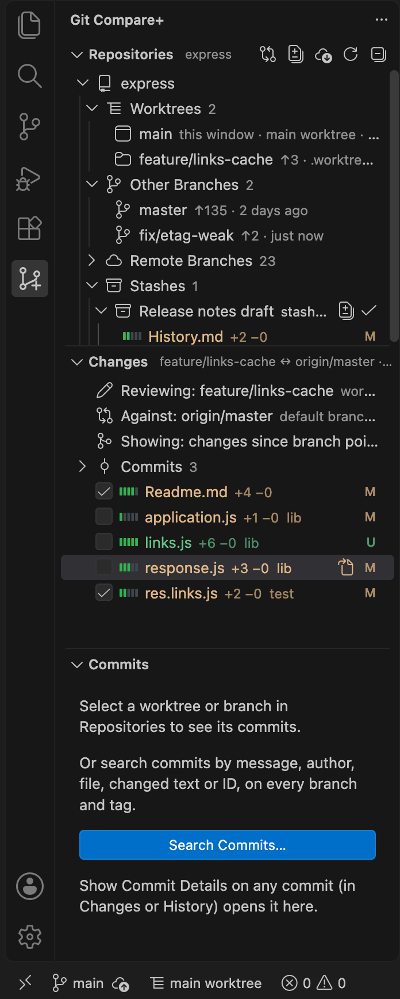
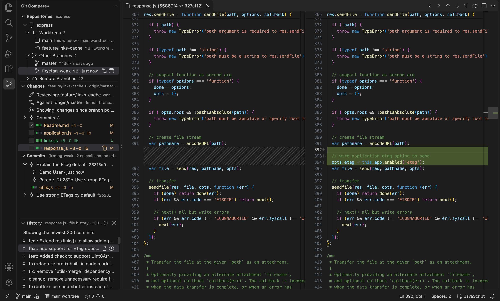
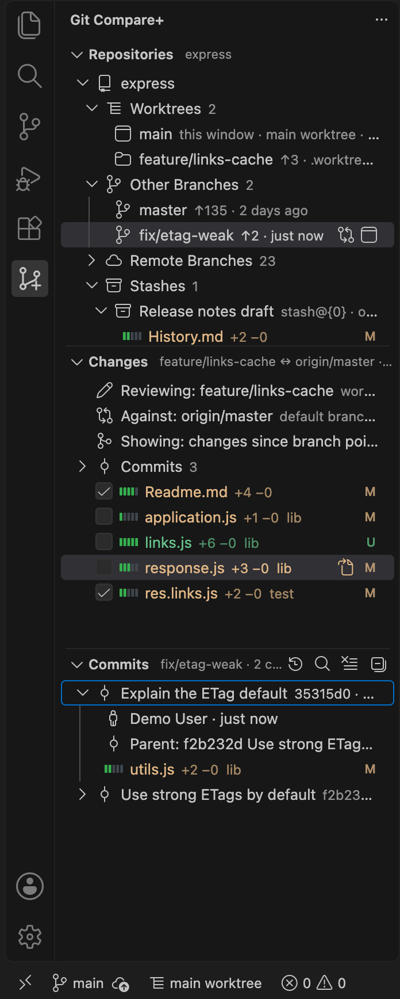
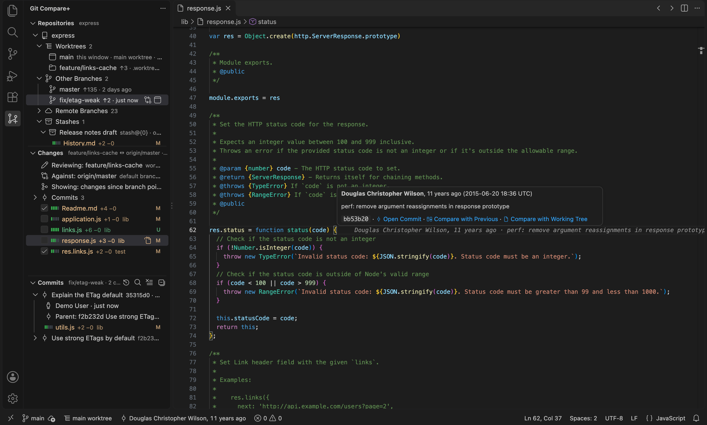

# Git Compare+

**Compare worktrees, branches, tags and commits side by side, with blame, history, commit search
and stashes.** A fast, lightweight extension for VS Code and Cursor: as fast as git itself, with no
account, no sign-in, no upgrade prompts and no telemetry.

- **Two named sides, everywhere.** Every comparison says what you're *Reviewing* (the right side
  of every diff) and what it's *Against* (the left side). Pick either side from one grouped list:
  this window, worktrees, branches, remote branches, tags or commits.
- **Worktrees you can tell apart.** Every branch says where it's checked out, and **Open…** says
  what it will do before it does it: open that worktree, switch this window, or create a worktree.
- **Review tools.** Line counts and green/red diff bars per file, reviewed checkboxes that clear
  when a file changes, commits ahead/behind, the commits behind a comparison, and a folder view.
- **Blame and history.** The current line's author and commit at the end of the line; file and
  line history with comparisons against any version, branch or worktree; commit search by message,
  author, file, changed text or ID; stashes you can open, apply, pop and drop.
- **Many repos at once.** Works with one repository or a whole multi-root workspace, including
  linked worktrees that aren't open in the window.



<sub>Screenshots: [expressjs/express](https://github.com/expressjs/express) at v5.1.0, with a demo
branch, worktree, edits and stash added locally by `npm run screenshots`.</sub>

## Quick start

1. Click the **Git Compare+** icon in the activity bar.
2. Click **Compare…** (the compare button in the Repositories title bar). Pick what to review (the
   worktree open in this window is preselected), then what to compare it with (the default branch
   is preselected).
3. Click a file in **Changes** to see its diff. Tick its checkbox once you've reviewed it.

To review a branch or worktree against the default branch in one click, hover its row in
Repositories and click its compare button.

## Requirements

- VS Code 1.90 or later, or Cursor, with the built-in Git extension enabled.
- git on your PATH (the same one the editor uses). git 2.41 or later counts commits ahead/behind for
  every branch in one go; older versions count local branches only.
- The workspace must be trusted: git can run programs named in a repository's own configuration
  (hooks, `core.fsmonitor`), so the extension is disabled in Restricted Mode.

## Features

### Comparing

Click the **Git Compare+** icon in the activity bar (the left-hand icon strip).
The sidebar has three sections: **Repositories**, **Changes** and **Commits**. A fourth,
**History**, appears when you ask for a file's history and closes with its ✕.

**Every comparison has two named sides,** used the same way everywhere:

- **Reviewing**: what changed. It's the right side of every diff.
- **Against**: what it's compared with. It's the left side.

The quickest way to start is **Compare…** (the compare button in the Repositories title bar, or the
Command Palette). It asks two questions, "What do you want to review?" and "Compare it with…".
Both lists are grouped the same way: *This window* (the worktree open here), *Worktrees*,
*Branches*, *Remote branches*, *Tags*, and *Commits* (search recent commits by message, author or
ID). You can also type any branch, tag or commit ID. The default branch is preselected for the
second question.



#### The Changes view

**Changes** starts with three header rows that say exactly what was compared. Click a row to
change that part, and the comparison re-runs:

```
✎  Reviewing: feature-x    worktree · INCLUDING uncommitted edits          ← click: include / exclude
⇄  Against: origin/master  default branch · click to change               ← click: pick something else
⑂  Showing: changes since branch point · click for all differences        ← click: switch mode
```

The Reviewing row has a button to review something else against the same Against side. Both
side rows have a ⇄ button that swaps them. Branches, tags and
commits say which they are (`tag · committed work`), and a commit shows its short ID and message
rather than a bare SHA.

Below the header are the changed files, with A/M/D/R/U badges and lines added and removed
(`+12 −3`, or `binary`). Each file's icon is a small GitHub-style bar of five squares: green for
added lines, red for removed, grey when fewer than five lines changed. Hover a file for the
counts in colour and in words. Binary files keep their normal file-type icon. The view title and
each repo row show the totals. When several repos are compared, files are grouped by repo; repos with no changes are hidden and counted at the top.
Click a file to open its diff in the editor.

**Commits:** a collapsed **Commits** group (per repo) lists the commits the comparison covers,
newest first: since the branch point, or the commits the base doesn't have in "all differences"
mode. Each row shows the short ID, author and age. Click a commit to open the files it changed in
one diff, compared with its parent. The comparison stays as it was. Right-click for **Compare
With This Commit**, which shows only what came after it, and **Copy Commit ID**. Uncommitted edits
aren't commits, so they never appear here. The list shows the newest 200 (`200+`). It isn't shown
when the base includes uncommitted edits, because that snapshot has no history.

**Reviewed checkboxes:** tick a file once you've reviewed it. The view title and each repo row
count the reviewed files (`14 files · 3 reviewed · +320 −45`). A mark covers that exact version of
the diff, so it clears by itself as soon as the file changes on either side, after an edit or when
the base moves. It survives things that don't change the diff: committing the file as it was,
switching uncommitted edits on or off, or a window reload. Marks are saved per workspace and per
repository, so the same diff seen from another worktree counts as reviewed too.

Line counts come from the same two sides as the file list. Untracked files are counted from disk,
except ones larger than 2 MB, which are listed without a count. If the counts can't be worked out,
the files are still listed, just without them.

Right-click a file for **Open File**, the file itself: the real file, editable, when the
comparison includes uncommitted edits. **Open File at Base** opens the base version, read-only.
Each is hidden when that side doesn't exist (a new or deleted file). Open File is also a button
on the row.

The title bar has **Open All Changes** (every file in one scrolling diff), **Refresh Comparison**
(re-run now; normally this happens automatically), **Fetch and Refresh**, **View as Tree / View as
List** and **Clear**. In tree view, files are grouped into folders with their own totals, and a
folder that only holds one other folder is combined with it (`src/views`). The choice is saved as
the `gitComparePlus.changesLayout` setting. The `…` menu has the three header actions plus **Swap
Sides**: what you were reviewing becomes the base, and the base becomes what you review (one repo
at a time). Each side keeps whether it includes uncommitted edits.

If the base is a remote branch that hasn't been fetched recently, the **Against:** row turns into a
warning: `fetched 3 days ago, may be out of date`.

#### What exactly is compared

**What you're reviewing (right-hand side)**

| You select                 | Right-hand side                                                           |
| -------------------------- | ------------------------------------------------------------------------- |
| repo / worktree (default)  | the files on disk: commits plus staged, unstaged and untracked edits      |
| repo / worktree, committed only | the worktree's last commit (HEAD). The header says how many uncommitted files are **NOT included** |
| branch                     | the branch's latest commit                                                |

For the files-on-disk case, the right-hand side is the real file, so you can edit it directly in
the diff editor.

**What it's compared with (left-hand side)**

| Base                                  | Left-hand side                                                    |
| ------------------------------------- | ----------------------------------------------------------------- |
| default branch / any branch or ref    | that branch (where your work split off from it, by default)       |
| worktree, committed only              | that worktree's last commit (HEAD); its uncommitted files are counted as NOT included |
| worktree, including uncommitted edits | a **snapshot** of that worktree's files on disk, retaken on every Refresh |

**Mode**

- **Changes since branch point** (default): like a pull request. The comparison starts from where
  your branch split off from the base, so commits added to `main` after that don't show up as
  changes.
- **All differences**: every difference between the two sides. This mode is required when the base
  includes uncommitted edits, because those edits have no branch point.

A snapshot is built from a temporary copy of the worktree's git index. That worktree's files and
staging area are never modified. The only side effect is that git stores unreferenced copies of
the edited files, which `git gc` cleans up later.

### Repositories, worktrees and branches



**Repositories**: every repo in the window. In a single-repo window it opens already expanded.
Each section's header says what it holds: Repositories names the repo (or how many), Changes names
both sides (`feature-x ↔ origin/main · 14 files · +320 −45`), and Commits and History name the
branch or file they're showing.

```
orders-service     feature/login-retry
├─ Worktrees  2
│  ├─ feature/login-retry   main worktree
│  └─ claude/feature-x             .claude/worktrees/feature-x
├─ Other Branches  12
├─ Remote Branches  31
└─ Stashes  2
```

**Order:** in each group, the repo's default branch comes first, then `main`, then `master`.
Everything else follows, newest commit first. The main worktree is always first under Worktrees.
Each worktree and branch shows the age of its latest commit (`3 days ago`). The Compare pickers
list branches in the same order.

**Ahead/behind:** each worktree and branch also shows how far it has moved from the repo's
default Against. `↑3 ↓12` means 3 commits the Against side doesn't have, and 12 commits on it that
this row doesn't have. A row level with it shows no arrows; hover for the counts in words. The
counts follow the default Against: change it and every row recounts. A worktree counts from its
last commit. With git 2.41 or later, every branch is counted in one git command.
Older git (Apple's bundled git can lag behind) counts local branches and detached worktrees one
by one, and remote branches show no counts.

- **Compare button** (hover over a repo, worktree or branch): review it against the
  repo's **default Against**. Every repo row says what that is (`against origin/main`). It's the
  repo's default branch (`origin/HEAD`, which is `master` or `main` depending on the repo) unless
  you've changed it. If `origin` is your fork, set `gitComparePlus.remote` to `upstream`; to pick a
  different default branch for one repo, use `gitComparePlus.defaultBranches`.
- **Right-click → Review Against…**: review that item against anything in the grouped picker.
- **Right-click a repo → Change Default Against…**, or **right-click a worktree or branch → Use
  as Default Against**: from then on, the compare button for that repo uses it. That item gets a
  target marker. **Reset Default Against** goes back to the default branch. The choice is
  saved per workspace.
- **Right-click a worktree → Open Worktree in New Window**.
- **Select** a worktree or branch to list its commits in the **Commits** view (see below).
- **Title bar**: **Compare All Repos** compares every repo's main worktree with its own default
  branch in one go; **Fetch All Repos** fetches every repo.

Each repo row shows when it was last fetched (`fetched 3 h ago`). If that's longer than
`staleFetchHours`, the row turns yellow, because comparisons with `origin/…` may be missing newer
commits.

**Each branch is listed once.** A branch checked out in a worktree is that worktree's row under
**Worktrees** (the worktree open in this window is marked `this window`). **Other Branches** lists
the local branches checked out nowhere. Remote branches say where their local copy is, if there is
one (`local copy in this window`, `local copy in worktree .wt/x`).

**Open…** (a button on each branch row, or right-click) does one thing, decided by where the branch
lives, and tells you before it does it:

| The branch is… | Open… |
| --- | --- |
| in this window | Says so. Nothing changes. |
| in another worktree | Opens that worktree in a new window. Nothing changes on disk. |
| not checked out | Asks which you want. **Switch this window to it** changes the files in this window's folder; it's refused if that folder has uncommitted changes, and nothing is stashed for you. **Create a worktree for it** makes a separate folder (`<repo>.worktrees/<branch>` next to the repo) and opens it in a new window, leaving your current work untouched. |

Opening a remote branch with no local copy creates the local branch, tracking the remote one.

**Status bar:** `main worktree` or `.claude/worktrees/x` (with a tree icon) shows which
worktree this window is on. The editor's own branch indicator names the branch, not the folder.
Click it for **Go to…**: every worktree and branch of this repo, each saying what picking it will
do ("this window", "opens in a new window", "not checked out: switch to it or create a
worktree").

#### Git actions (right-click)

Only actions you'd take while reviewing are here. Commit, push, pull, merge and rebase stay in the
editor's Source Control view.

| Action | On | Safety |
| --- | --- | --- |
| **Fetch** | repo (or title bar: all repos) | Runs without prompting for credentials; if git needs a password it hasn't stored, the fetch fails quickly and the reason is shown. |
| **Create Branch From Here…** | repo, worktree, branch | Doesn't switch to the new branch. Optionally creates a worktree for it right after. |
| **Create Worktree…** | branch not checked out anywhere, or a remote branch | A remote branch gets a local branch with the same name that tracks it. The suggested folder is `<repo>.worktrees/<branch>` next to the repo. |
| **Open…** | any branch | See the table above: says what it will do before doing it. |
| **Switch Main Worktree to This Branch** | branch not checked out anywhere, or a remote branch | Refused while the main worktree has uncommitted changes. Nothing is carried over or stashed for you. (Open… does the same for this window's worktree.) |
| **Remove Worktree(s)…** | one or more linked worktrees | Confirmation names each folder and how many uncommitted files would be **permanently deleted**, plus the total. It also warns when a worktree was created by Claude Code. Branches are kept. |
| **Delete Branch(es)…** | one or more local branches not checked out anywhere | Confirmation lists how many commits each branch has that aren't in the default branch and would be lost, plus the total. |

**Stashes** (under each repo, collapsed at first) lists the repo's stashes, newest first:
`my work · stash@{0} · on main · 2 h ago`, or `Uncommitted changes on main` for an unnamed one.
Stashes belong to the repo, so every worktree shows the same list. Expand one to see its files,
with badges, line counts and diff bars; files saved with `--include-untracked` say `(untracked)`.
Click a file for its diff.

| Action | What it does |
| --- | --- |
| **Open Stash Changes** (row button) | every file of the stash in one diff |
| **Apply Stash (keep it)** (row button) | applies it to this window's worktree of the repo (or the main worktree if none is open here) and says which; the stash stays |
| **Pop Stash (apply and remove)** | the same, then removes the stash; if applying fails, git keeps it |
| **Drop Stash…** | confirms first, saying how many changed files are lost, then deletes it |

Applying is refused by git when the stash conflicts with uncommitted changes in that worktree;
git's message is shown. Stash numbers (`stash@{0}`) shift when stashes are added or removed, so Pop
and Drop look the stash up again by its ID right before acting.

**Deleting several at once:** select multiple items with Cmd/Shift-click, even across repos.
Then right-click, or press **Cmd+Backspace** (**Delete** on Windows/Linux). One confirmation
covers the whole selection. Items that can't be deleted are listed as **Skipped** with the reason:
a checked-out branch, a remote branch, or the main worktree. With the Delete key, a selection that
mixes worktrees and branches removes the worktrees first. That way, a branch whose only
checkout was one of those worktrees is deleted in the same pass.

### History

Right-click a file for **Show File History**: in the editor, the Explorer, a changed file in
Changes, a file of a commit in Commits, or a file in a stash. The **History** section appears with
each commit that changed that file, newest first, following renames (older rows show the old name).
Select lines and right-click → **Show Line History** to list only the commits that changed those
lines.

History stays on the file you asked for: switching editors doesn't change it, and asking for
another file replaces it. Its ✕ closes it; it's also closed after a window reload.



Every commit row compares in the same ways:

| Action | Shows (this file only) |
| --- | --- |
| click (**Compare with Previous**) | the file just before vs at that commit |
| **Compare with Working Tree** (row button) | the file at that commit vs as it is now, editable |
| **Compare with Branch, Tag or Commit…** | the file at that commit vs anything in the grouped picker, including another worktree |
| **Select for Compare**, then **Compare with Selected** | two commits of the file |
| select two rows, **Compare These Two** | the older on the left, the newer on the right |

Every history row also has the whole-commit actions shared by all commit lists (see **Commits**
below), such as **Review This Commit** and **Show Commit Details**.

**Stepping through versions:** the ◀ ▶ buttons in the editor title
move through the file's versions one at a time. Each diff shows one version against the one
before it, so the left side is always "just before" the right. From a file with uncommitted
changes, the first step back shows those changes. They work whether or not History is open; a
file's history loads the first time you press one and is reused until git changes.

Line history uses the committed version's line numbers. If you've edited the file since, the
lines may have moved.

### Commits: a branch's commits, search and details

**Select a worktree or branch in Repositories** and the **Commits** view lists its commits:

- what it has that the repo's default Against doesn't, e.g. `3 commits not on origin/main` (the
  same commits its ↑3 counts), so you see what you'd be reviewing;
- or, when there's nothing like that (selecting `main` itself, say), its recent history, saying
  why: `history · 200+ commits · nothing that origin/main doesn't have`.



The history button in the view's title bar switches to the full history, and back. Selecting a repo
row lists its main worktree. Nothing is switched or opened; it only lists. Selecting several rows
(to delete them) leaves the list alone.

The view also has **Search Commits…** (search button in its title bar). Choose what to search by,
then type:

| Search by | Finds |
| --- | --- |
| Message | commits whose message contains the text (not case-sensitive) |
| Author | commits by an author whose name or email contains the text |
| File | commits that changed a file whose path contains the text, e.g. `login` or `src/auth/` |
| Changed text | commits that added or removed the text in some file, e.g. a function name |
| Commit ID | one commit by full or short ID, or a tag |

Searches cover every branch and tag, newest first, up to 200 results.

Expand a commit to see its details: author and date, its parent (click it to show that commit),
and the files it changed, with the same badges, line counts and diff bars as Changes. Click a
file for its diff. Hover the commit for its full message. **Show Commit Details** on a commit in
Changes or History opens it here.

**The same actions on every commit**, whether it's in the Commits group in Changes, in History, or
here:

| Action | Shows, in Changes |
| --- | --- |
| **Review This Commit** | Reviewing = the commit, Against = its parent |
| **Review Changes Since This Commit** | Reviewing = the worktree, Against = the commit |
| **Review This Commit Against…** | the commit against anything in the grouped picker |
| **Select Commit for Compare**, then **Review Against Selected Commit** | this commit against the selected one |
| select two, **Compare These Two Commits** | the newer one against the older one |
| **Open Commit (all files)**, **Copy Commit ID** | one multi-file diff; the full ID |

History rows also have the file-only comparisons described above.

### Blame

Put the cursor on a line and, after a moment, the end of that line shows who last changed it and
when: `Ada Lovelace, 3 days ago · Fix login retry`. Lines you've changed but not committed, or not
saved yet, say `Uncommitted change`. Hover the note for:

- the full commit message, author and date, and the short commit ID;
- **Open Commit**: every file the commit changed, in one diff;
- **Compare with Previous**: this file just before and just after the commit (follows renames);
- **Compare with Working Tree**: this file at the commit against the file as it is now.

The status bar shows the same author and age (`Ada Lovelace, 3 days ago`); click it
to open the commit.



Blame runs once per version of a file and is reused as you move around. While you type, the note
is hidden until you pause. Files outside git, never-committed files and files over 20,000 lines are
skipped. Turn the parts off with `gitComparePlus.blame.currentLine` and `gitComparePlus.blame.statusBar`.

### Staying current

Both views update themselves; you only need **Refresh** if you've turned automatic refresh off.

| View | Updates when | How |
| --- | --- | --- |
| **Repositories** | You commit, switch, create or delete branches, add or remove worktrees, or fetch, whether in Source Control, the terminal or Claude Code | Follows the editor's git change events. Each repo reloads about 1 s after changes stop, and the tree redraws only if something actually changed. |
| **Changes** | Files change in a compared worktree (edits, saves, new or deleted files), or the git state of a compared repo changes | Watches the compared worktree folders, including ones not open in this window, plus git events for the repos involved. Re-runs about 1.5 s after changes stop and redraws only if the results differ. Turn off with `gitComparePlus.autoRefresh`. |
| **Ages** (`3 h ago`, stale fetch) | Every minute | Redraw only, no git commands. |

Changes inside `.git`, `node_modules`, `dist`, `build`, `out`, `coverage`, `cdk.out` and
similar folders don't trigger a re-run.

**When a background refresh fails** (for example git's `index.lock` held during a rebase, or a
worktree folder deleted from under the view), the view keeps showing what it had, and says so:

- The message bar at the top of the view reads `⚠ Couldn't refresh <repo or comparison> (2 min
  ago): <reason>. Showing earlier results; Refresh to retry.` In Repositories, the affected repo
  also gets a warning icon.
- No popup appears for a one-off failure; most clear up on the next refresh a second later.
- If it keeps failing (3 times in a row, or for a minute), **one** notification appears for that
  run of failures, with **Show Log** plus **Refresh** (Repositories) or **Turn Off
  Auto-Refresh** (Changes). It won't appear again until a refresh has succeeded.
- The next successful refresh, automatic or manual, removes the message without a popup.
- Errors from actions you start yourself (compare, fetch, delete…) still show immediately.

**Fetching is never automatic:** it contacts your git host using your credentials. If the editor's
own `git.autofetch` is on, the remote branches it fetches show up here automatically.

## Settings

| Setting                            | Default            | Meaning                                                             |
| ---------------------------------- | ------------------ | ------------------------------------------------------------------- |
| `gitComparePlus.includeUncommitted` | `true`             | Start worktree comparisons with uncommitted edits included.         |
| `gitComparePlus.includeUntracked`   | `true`             | Treat never-added files as uncommitted edits (shown, or counted).   |
| `gitComparePlus.compareMode`        | `sinceBranchPoint` | Starting mode: `sinceBranchPoint` or `allDifferences`.               |
| `gitComparePlus.staleFetchHours`    | `24`               | After this many hours without a fetch, a repo is flagged as out of date. |
| `gitComparePlus.remote`             | `origin`           | Remote whose HEAD branch is the default branch (`upstream` for forks). |
| `gitComparePlus.defaultBranches`    | `{}`               | Per-repo default branch, keyed by folder name or main-worktree path: `{ "api": "upstream/develop" }`. |
| `gitComparePlus.blame.currentLine`  | `true`             | Blame note at the end of the current line, with its hover and actions. |
| `gitComparePlus.blame.statusBar`    | `true`             | Author and age of the current line in the status bar.               |
| `gitComparePlus.changesLayout`      | `list`             | Changes view layout: `list` or `tree` (folders). Title bar toggles it. |
| `gitComparePlus.autoRefresh`        | `true`             | Re-run the comparison in Changes automatically when its inputs change.   |

Logs are under **View → Output → Git Compare+**. For more detail, run
**Developer: Set Log Level…** and choose Debug.

## Fast

Git Compare+ is as fast as git itself: almost all of the time is git's own work, and where an
action needs several git commands, it runs them at the same time. Measured on git/git (75,031
commits, 4,525 files) with `npm run bench`:

| Action | Git Compare+ (median of 5) | git alone |
| --- | --- | --- |
| Compare two releases (842 files, with line counts and commit list) | 149 ms | 146 ms (`git diff --numstat`) |
| Review a worktree with uncommitted edits (844 files) | 230–360 ms (varies between runs) | |
| Blame a 6,800-line file, including unsaved edits | 418 ms | 481 ms (`git blame --incremental`) |
| File history (200 commits, following renames) | 256 ms | 308 ms (`git log --follow`) |
| Line history (40 lines) | 669 ms | |
| Search commit messages / authors | 21 ms / 50 ms | |
| Search by file path | 289 ms | |
| Search changed text (`-S`, every branch) | 1.7 s | 1.8 s (`git log -S`) |
| Commits ahead/behind for every branch | 386 ms | |
| Load a repository (worktrees, branches, default branch) | 7 ms | |

Apple M5 Pro, git 2.53, Node 24, 2026-10-22. The "git alone" column is the same git command run
from a shell, which includes starting a process each time. Your numbers depend on your machine and
repository; run `npm run bench` to measure your own. CI runs the benchmark on every push and fails if
any action gets about ten times slower.

What you see in the editor also includes two short deliberate pauses: blame waits about 0.15 s
after the cursor stops (so holding an arrow key doesn't blame every line it passes), and Changes
waits about 1.5 s after you stop typing before it refreshes.

## Lightweight by design

| | Git Compare+ 1.0.0 |
| --- | --- |
| Download size | about 80 KB (one 142 KB bundle, no runtime dependencies) |
| Startup cost | none: it activates after the editor has finished starting; `activate()` itself takes a few milliseconds |
| Network | only when you click Fetch; no telemetry, no account |
| Background work | git runs only for what's on screen: a shown comparison, an open History view, the current line's blame |

The size budget (`npm run budget`) and the activation check (`npm run test:host`) run in CI on
macOS, Linux and Windows.

## Known limitations

- Developed and tested by hand on macOS. Linux and Windows are covered by the automated tests in
  CI, but haven't been tried by hand yet.
- Line history uses the committed version's line numbers; if you've edited the file since, the
  selected lines may have moved.
- No commit graph, interactive rebase editor or pull-request integration.

## Contributing

See [CONTRIBUTING.md](CONTRIBUTING.md) for building, testing, and how the code is organised.

## License

[MIT](LICENSE) © Blaazin Software Consulting Inc.
